# Отчёт по лабораторной работе №3. Облачные сети. Amazon VPC

**ФИО:** Дарья Буртева  
**Группа:** IA2403  
**Специальность:** Informatică Aplicată  
**Номер k (X):** X = 6  
**Выбранный уровень:** Продвинутый  
**Ссылка на репозиторий:** https://github.com/burtevadaria-cloud/lab3

---

## 1. Скриншоты базового уровня

### Задание 1. План адресов

| Подсеть | Зона доступности | Диапазон | Первый и последний адрес | Доступно адресов |
| :--- | :--- | :--- | :--- | :--- |
| public-a | eu-central-1a | 10.6.0.0/24 | 10.6.0.4 – 10.6.0.254 | 251 |
| public-b | eu-central-1b | 10.6.1.0/24 | 10.6.1.4 – 10.6.1.254 | 251 |
| private-a | eu-central-1a | 10.6.10.0/24 | 10.6.10.4 – 10.6.10.254 | 251 |
| private-b | eu-central-1b | 10.6.11.0/24 | 10.6.11.4 – 10.6.11.254 | 251 |

### Задание 3. Маршруты

Маршруты таблиц public-rt и private-rt и их связи с соответствующими подсетями.

### Задание 4. Security Groups
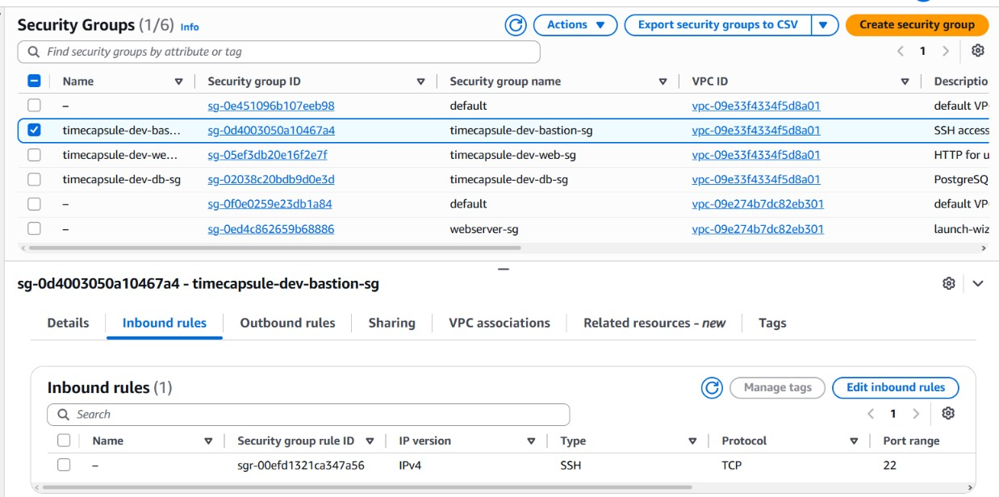
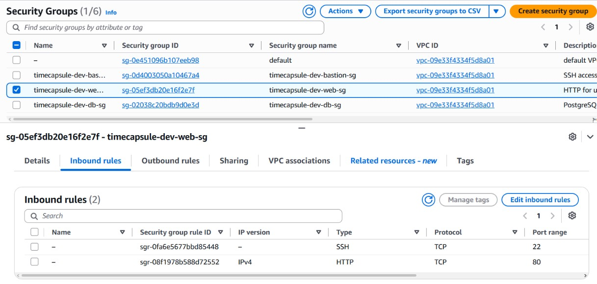
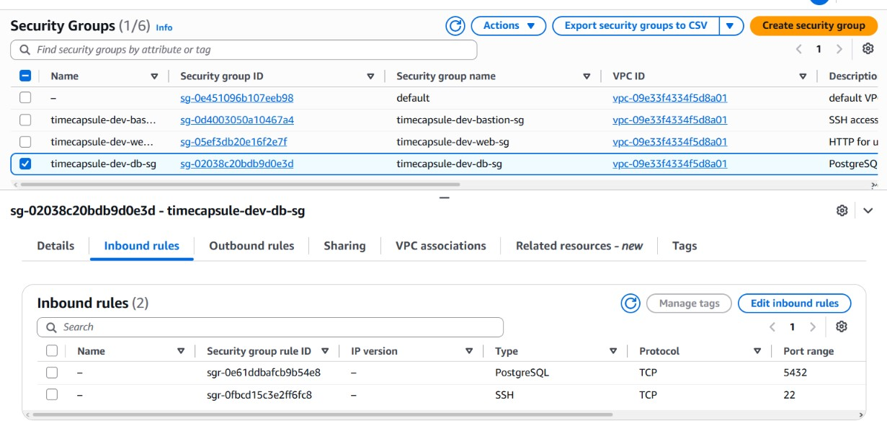
Входящие (Inbound) правила групп bastion-sg, web-sg и db-sg.

### Задание 5. Экземпляры

Страница web-server в браузере с приватным IP и зависшая установка пакета на db-server.

### Задание 6. NAT Gateway

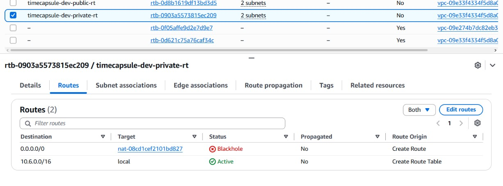

Вывод curl checkip на db-server, маршрут в состоянии Blackhole и удаленный NAT Gateway.

### Задание 7. Проверки
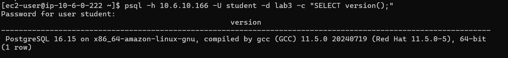
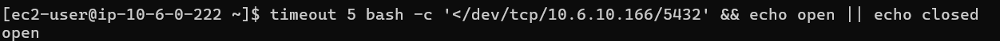
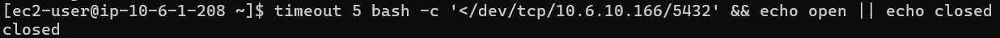

Вывод psql, результат проверки порта 5432, недоступность по ACL и список ресурсов в Tag Editor.

---

## 2. Скриншоты продвинутого уровня

### Задание 9. Elastic IP

Открытое в браузере приложение по постоянному адресу Elastic IP.

### Задание 11. Приватная зона Route 53
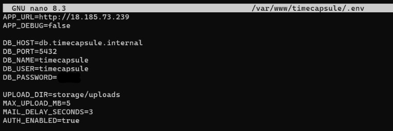

Запись БД в зоне timecapsule.internal, успешный dig с app-server и неудачный с локального ПК.

### Задание 12. Перенос данных
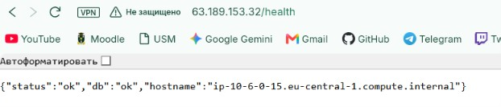
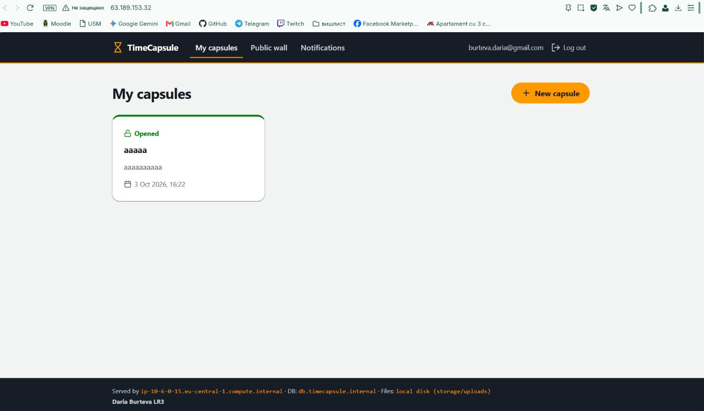
Jтвет /health "db":"ok" и наличие капсул из ЛР2 на сайте.

### Задание 13. Обслуживание

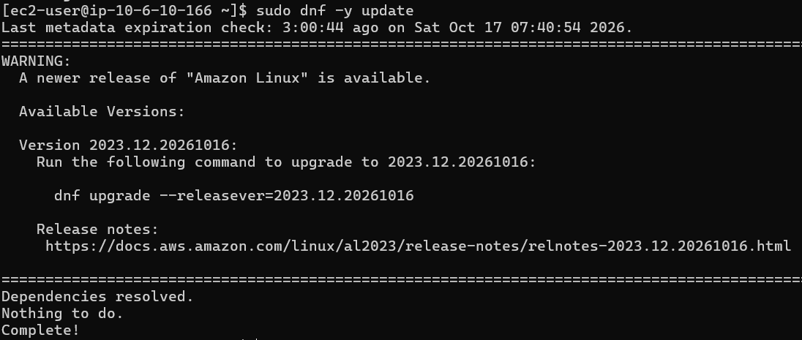
Изменение подвала на "LR3", ответ /health при выключенной БД и обновление пакетов dnf update через NAT Gateway (Вариант A).

---

## 3. Архитектура
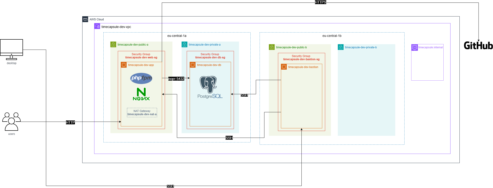
Архитектурное решение описано в [ADR-0002](docs/adr/0002-database-placement.md).

---

## 4. Ответы на контрольные вопросы

**Задание 1. Почему доступных адресов не 256? Какие адреса подсети 10.X.0.0/24 занимает AWS и для чего? Сколько ещё подсетей /24 поместится в вашу VPC?**
AWS резервирует 5 адресов в каждой подсети: адрес сети, маршрутизатор VPC, DNS-сервер, резерв для будущего и широковещательный адрес. В VPC с CIDR /16 поместится 256 подсетей с маской /24.

**Задание 2. Является ли подсеть public-a сейчас публичной? Почему?**
Нет. Для выхода в интернет ей не хватает маршрута к Internet Gateway в таблице маршрутизации.

**Задание 3. Какой маршрут есть в обеих таблицах, хотя вы его не добавляли? Что он даёт? Куда уйдёт пакет из private-a, адресованный 8.8.8.8?**
В обеих таблицах есть локальный маршрут (`10.6.0.0/16 -> local`) для связи ресурсов внутри VPC. Пакет из private-a на 8.8.8.8 будет отброшен, так как маршрута в интернет нет.

**Задание 4. Почему в db-sg источником указана группа web-sg, а не адрес веб-сервера или диапазон 10.X.0.0/16?**
Это делает архитектуру гибкой и масштабируемой. Если IP-адрес веб-сервера изменится или добавятся новые серверы в web-sg, правила файрвола базы данных обновлять не придется.

**Задание 5. Почему db-server не может скачать пакеты, хотя web-server это делает? Что нужно добавить в сеть, чтобы это стало возможно, и при этом db-server остался недоступным из интернета?**
У db-server нет публичного IP и маршрута в интернет. Для скачивания пакетов нужно временно добавить NAT Gateway в публичную подсеть и направить на него маршрут.

**Задание 6. Какой адрес вернула первая команда? Сравните его с Elastic IP NAT Gateway. Почему PostgreSQL продолжает работать после удаления NAT Gateway?**
Команда `checkip` вернула Elastic IP шлюза NAT Gateway, так как исходящий трафик маскируется под его адресом. PostgreSQL продолжает работать, потому что соединения от веб-сервера идут по внутренней сети VPC.

**Задание 7. Почему заблокировано и SSH, и сайт, хотя вы не меняли ни одной Security Group? Почему с телефона сайт открывается? Почему правило должно иметь номер меньше 100?**
Network ACL заблокировал трафик на границе подсети по правилу 90. С телефона сайт открылся из-за смены внешнего IP. Правило 90 выполняется раньше дефолтного разрешающего правила 100 из-за меньшего номера.

**Задание 8. Что содержит образ? Какие данные из ЛР2 оказались на app-server без всякой установки? Где сейчас хранится база данных приложения?**
Образ содержит ОС, пакеты (Nginx, PHP) и код приложения. База данных осталась на старом сервере ЛР2 в default VPC, её в образе нет.

**Задание 9. Почему Elastic IP нужен app-server, но не нужен bastion? Сколько стоит Elastic IP, пока сервер остановлен, и почему?**
Elastic IP сохраняет постоянный адрес сайта для пользователей после перезагрузок. За остановленный сервер он стоит $0.005/час, чтобы мотивировать освобождать неиспользуемые адреса.

**Задание 10. Зачем для базы в отдельной сети нужен новый сильный пароль, если порт 5432 и так закрыт Security Group?**
Для защиты, если злоумышленник взломает веб-сервер (внутри web-sg), он не получит доступ к БД без пароля.

**Задание 11. Почему с app-server имя находится, а с вашего компьютера нет? Что придётся изменить, если db-server пересоздадут с другим адресом?**
Зона `timecapsule.internal` — приватная, доступна только внутри VPC. При пересоздании сервера нужно обновить только одну А-запись в Route 53.

**Задание 12. Файлы, которые пользователи прикрепили к капсулам, переехали вместе с образом, а не вместе с базой. Где они лежат? Что с ними будет, если app-server удалить?**
Они лежат локально на EBS-диске app-server. При удалении сервера файлы будут уничтожены.

**Задание 13. Почему в самом deploy.sh ничего менять не пришлось? Почему nat-down.sh должен освобождать Elastic IP только после того, как NAT Gateway удалён?**
Скрипт `deploy.sh` работает локально на сервере, не завися от внешней сети. Elastic IP нельзя освободить, пока он привязан к шлюзу NAT, поэтому нужно дождаться полного удаления шлюза.

### Вопросы продвинутого уровня

**1. Как проходит запрос пользователя от браузера до базы данных? Какие маршруты и какие правила фильтрации он проходит на каждом шаге?**
Браузер $\rightarrow$ Internet Gateway $\rightarrow$ NACL подсети public-a $\rightarrow$ SG web-sg $\rightarrow$ app-server. Запрос к БД: app-server $\rightarrow$ локальный маршрут VPC $\rightarrow$ NACL подсети private-a $\rightarrow$ SG db-sg $\rightarrow$ db-server.

**2. Злоумышленник знает приватный IP db-server. Что ему нужно получить, чтобы подключиться к базе?**
Ему нужно скомпрометировать ресурс, входящий в группу `web-sg` (например, взломать app-server), либо получить SSH-доступ к `bastion`, а также узнать пароль от самой БД.

**3. Чем временный NAT Gateway лучше постоянного, и какие неудобства он создаёт?**
Экономит деньги (нет почасовой платы за простой).  
Неудобство - необходимость поднимать шлюз вручную (или скриптом) каждый раз, когда нужно установить обновления.

**4. Как изменится схема, если приложение должно пережить отказ зоны eu-central-1a? Каких ресурсов для этого не хватает?**
Потребуется второй `app-server` в подсети `public-b` и реплика БД в `private-b`. Для распределения запросов между серверами понадобится Application Load Balancer в публичных подсетях.